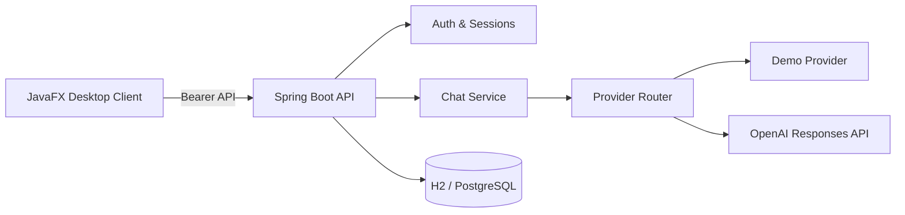

<p align="center">
  
</p>

<p align="center">
  <strong>Private conversations. Focused work. One intelligent workspace.</strong><br />
  A cross-platform desktop AI client with a secure Spring Boot backend, persistent chat history and pluggable providers.
</p>

<p align="center"><strong>English</strong> · <a href="README.ru.md">Русский</a></p>

<p align="center">
  <a href="https://github.com/ro22-it/nexus-ai/actions/workflows/build.yml"></a>
  
  
  
  
</p>

## Why Nexus AI

Nexus AI is an engineering-first AI workspace: a native-feeling desktop client, a clean API boundary and a storage layer that keeps conversations available across sessions. The project starts in a safe demo mode and can be connected to a real provider without exposing API keys to the client.

## Product surface

- **Premium desktop experience** — dark glass-inspired JavaFX interface with sidebar navigation, chat cards and responsive states.
- **Authentication** — registration, login, bearer sessions, profile and password change with BCrypt hashing.
- **Conversation history** — independent sessions, switching between chats, deleting a session and persistent storage.
- **Provider routing** — demo provider for local development and OpenAI Responses API integration behind one server-side abstraction.
- **Secure-by-default configuration** — provider keys stay on the backend; local secrets and database files are ignored by Git.
- **Cross-platform packaging** — scripts for macOS `.app`, Linux and Windows packaging.

## Architecture



## Quick start

### Requirements

- Java 21+
- Docker Desktop — optional, for PostgreSQL
- macOS, Linux or Windows for the matching desktop package

### Run locally

```bash
./gradlew :nexus-server:bootRun
```

In a second terminal:

```bash
./gradlew :nexus-desktop:run
```

Verify the API:

```bash
curl http://localhost:8080/api/health
```

The default `demo` provider works without an API key, so the project can be explored immediately.

### Run with PostgreSQL

```bash
docker compose up -d postgres

DATABASE_URL=jdbc:postgresql://localhost:5432/nexus \
DATABASE_USERNAME=nexus \
DATABASE_PASSWORD=nexus \
./gradlew :nexus-server:bootRun
```

To enable OpenAI on the server:

```bash
export NEXUS_PROVIDER=openai
export OPENAI_API_KEY=your_key
export OPENAI_MODEL=gpt-6.2-astra
./gradlew :nexus-server:bootRun
```

Never place the key in the desktop client or commit it to the repository.

## API overview

| Area | Endpoint | Purpose |
| --- | --- | --- |
| Health | `GET /api/health` | Service health check |
| Auth | `POST /api/auth/register` | Create an account |
| Auth | `POST /api/auth/login` | Start a session |
| Auth | `GET /api/auth/me` | Read the current profile |
| Auth | `DELETE /api/auth/session` | Revoke the current token |
| Chat | `POST /api/chat` | Send a message |
| Chat | `GET /api/chat/sessions` | List saved conversations |
| Chat | `GET /api/chat/history` | Read a conversation |
| Providers | `GET /api/providers` | Inspect provider availability |

## Build, test and package

```bash
./gradlew test build --no-daemon
```

Package the desktop client on the target operating system:

```bash
./scripts/package-macos.sh
open nexus-desktop/build/jpackage/NexusAI.app
```

Linux and Windows equivalents are available in `scripts/`. GitHub Actions validates the project on macOS, Linux and Windows for every push and pull request.

## Repository layout

```text
 nexus-desktop/     JavaFX client and platform credential stores
 nexus-server/      Spring Boot API, auth, chat and provider routing
 scripts/            Platform packaging scripts
 docs/assets/        Project visuals used by the README
 .github/workflows/  Cross-platform CI
```

## Status

Nexus AI is an active product prototype. The foundation is in place: polished desktop shell, authentication, persistent sessions, provider abstraction, OpenAI integration and reproducible builds. The next product layer is richer model configuration, streaming responses and a refined onboarding experience.

## License

MIT — see [LICENSE](LICENSE).
