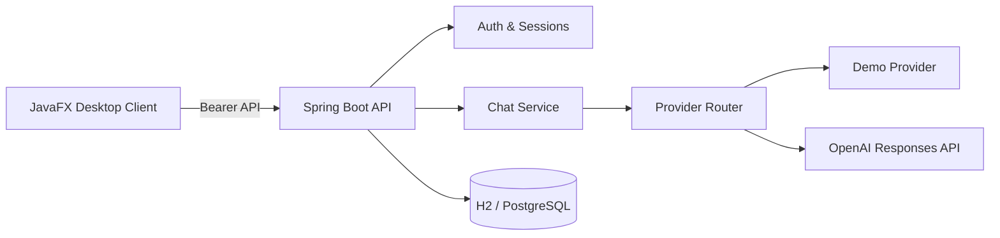

# Nexus AI

<p align="center">
  
</p>

<p align="center">
  <strong>Личные диалоги. Сфокусированная работа. Одно интеллектуальное пространство.</strong><br />
  Кроссплатформенный desktop-клиент с безопасным Spring Boot backend, историей диалогов и подключаемыми AI-провайдерами.
</p>

<p align="center"><a href="README.md">English</a> · <strong>Русский</strong></p>

<p align="center">
  <a href="https://github.com/ro22-it/nexus-ai/actions/workflows/build.yml"></a>
  
  
  
  
</p>

## Что такое Nexus AI

Nexus AI — инженерно выстроенное AI-пространство: нативно выглядящий desktop-клиент, чистая граница API и слой хранения, который сохраняет диалоги между запусками. Проект запускается в безопасном demo-режиме и подключается к реальному провайдеру без передачи API-ключей на клиент.

## Возможности

- **Премиальный desktop-интерфейс** — тёмный JavaFX UI в стиле glassmorphism с боковой навигацией и карточками сообщений.
- **Аутентификация** — регистрация, вход, bearer-сессии, профиль и смена пароля с BCrypt-хешированием.
- **История диалогов** — отдельные сессии, переключение между чатами, удаление сессии и постоянное хранение.
- **Маршрутизация провайдеров** — demo-провайдер для локальной разработки и интеграция OpenAI Responses API через единую абстракцию сервера.
- **Безопасность по умолчанию** — ключи провайдеров остаются на backend, а локальные секреты и базы исключены из Git.
- **Кроссплатформенная упаковка** — скрипты для macOS `.app`, Linux и Windows.

## Архитектура



## Быстрый старт

### Требования

- Java 21+
- Docker Desktop — опционально, для PostgreSQL
- macOS, Linux или Windows для сборки соответствующего desktop-пакета

### Локальный запуск

```bash
./gradlew :nexus-server:bootRun
```

Во втором окне терминала:

```bash
./gradlew :nexus-desktop:run
```

Проверка API:

```bash
curl http://localhost:8080/api/health
```

По умолчанию работает безопасный `demo`-провайдер, поэтому проект можно изучать без API-ключа.

### Запуск с PostgreSQL

```bash
docker compose up -d postgres

DATABASE_URL=jdbc:postgresql://localhost:5432/nexus \
DATABASE_USERNAME=nexus \
DATABASE_PASSWORD=nexus \
./gradlew :nexus-server:bootRun
```

Чтобы включить OpenAI на сервере:

```bash
export NEXUS_PROVIDER=openai
export OPENAI_API_KEY=your_key
export OPENAI_MODEL=gpt-6.2-astra
./gradlew :nexus-server:bootRun
```

Не размещай ключ в desktop-клиенте и не добавляй его в репозиторий.

## Основные API-эндпоинты

| Раздел | Endpoint | Назначение |
| --- | --- | --- |
| Health | `GET /api/health` | Проверка состояния сервиса |
| Auth | `POST /api/auth/register` | Создание аккаунта |
| Auth | `POST /api/auth/login` | Начало сессии |
| Auth | `GET /api/auth/me` | Текущий профиль |
| Auth | `DELETE /api/auth/session` | Отзыв текущего токена |
| Chat | `POST /api/chat` | Отправка сообщения |
| Chat | `GET /api/chat/sessions` | Список сохранённых диалогов |
| Chat | `GET /api/chat/history` | История диалога |
| Providers | `GET /api/providers` | Доступность провайдеров |

## Сборка и тесты

```bash
./gradlew test build --no-daemon
```

Сборка desktop-приложения на macOS:

```bash
./scripts/package-macos.sh
open nexus-desktop/build/jpackage/NexusAI.app
```

Эквивалентные скрипты для Linux и Windows находятся в `scripts/`. GitHub Actions проверяет проект на macOS, Linux и Windows после каждого push и pull request.

## Структура репозитория

```text
 nexus-desktop/     JavaFX-клиент и хранилища учётных данных
 nexus-server/      Spring Boot API, auth, chat и маршрутизация провайдеров
 scripts/            Скрипты упаковки под разные платформы
 docs/assets/        Визуальные материалы проекта
 .github/workflows/  Кроссплатформенный CI
```

## Статус

Nexus AI — активно развивающийся прототип продукта. Уже готовы desktop-оболочка, аутентификация, постоянные сессии, абстракция провайдеров, интеграция OpenAI и воспроизводимые сборки. Следующий слой продукта — настройка моделей, потоковые ответы и более глубокий onboarding.

## Лицензия

MIT — подробности в файле [LICENSE](LICENSE).
